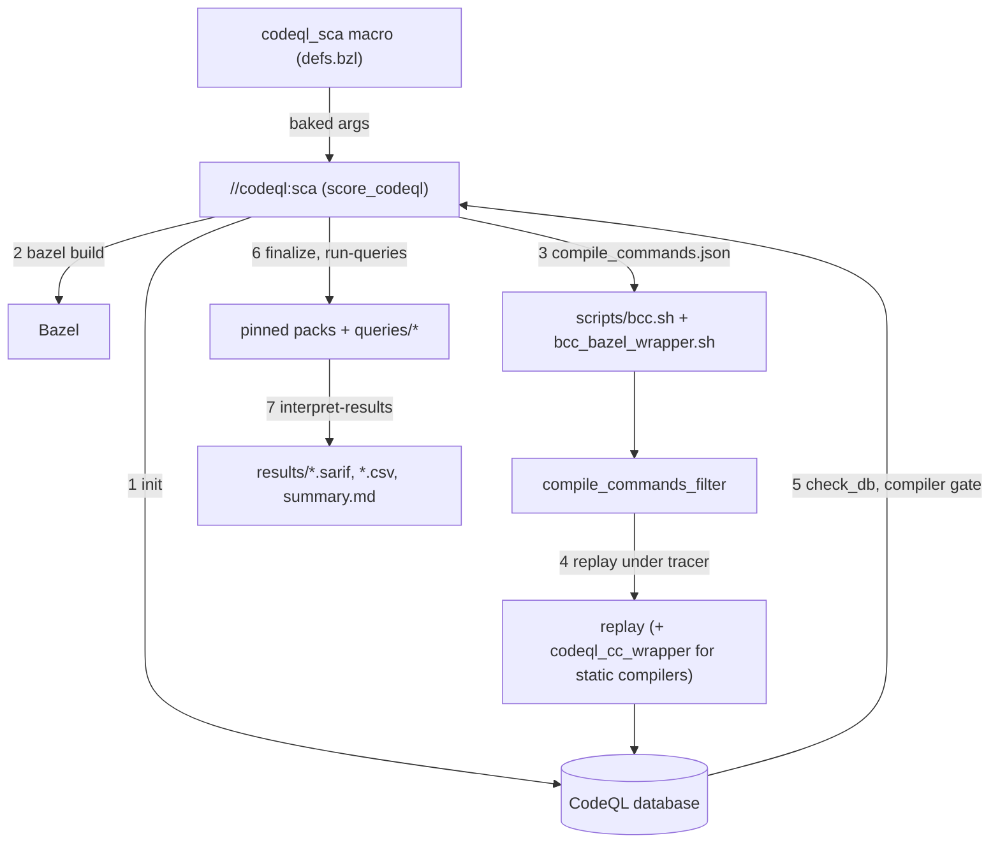

<!-- ----------------------------------------------------------------------------
  Copyright (c) 2026 Contributors to the Eclipse Foundation

  See the NOTICE file(s) distributed with this work for additional
  information regarding copyright ownership.

  This program and the accompanying materials are made available under the
  terms of the Apache License Version 2.0 which is available at
  https://www.apache.org/licenses/LICENSE-2.0

  SPDX-License-Identifier: Apache-2.0
----------------------------------------------------------------------------- -->

# CodeQL static analysis (SCA)

Bazel-integrated CodeQL analysis for C/C++ code bases. The package provides the
pinned CodeQL CLI, an orchestration tool (`//codeql:sca`), report and preset
definitions, local query packs and a macro (`codeql_sca`) that turns all of it
into one runnable target per repository.

- Both Linux and QNX builds are analysed by **replaying the compile commands**
  of a Bazel build under the CodeQL tracer (no full rebuild under the tracer).
- The analysis uses the **production compiler** (GCC for Linux, `qcc`/`q++` for
  QNX). There is no Clang fallback; if the production compiler cannot be
  extracted, the run fails (see [Compiler identity gate](#compiler-identity-gate)).
- Everything is pinned: CodeQL CLI, query packs, `bazel-compile-commands`. No
  "latest" is downloaded anywhere.
- Linux x86_64 hosts only (`target_compatible_with = @platforms//os:linux`).

## Quick start

Add the module to your `MODULE.bazel`:

```starlark
bazel_dep(name = "score_tools", version = "<release>")
```

Define a target in `tools/codeql/BUILD`:

```starlark
load("@score_tools//codeql:defs.bzl", "codeql_sca")

codeql_sca(
    name = "sca_linux",
    targets = [
        "//score/...",
        "-//score/mock/...",
    ],
    configs = ["x86_64-linux"],
    safety_level = "QM",
)
```

Run it:

```bash
# QM preset (code scanning + CERT + complexity) with the baked defaults
bazel run //tools/codeql:sca_linux

# ASIL preset (code scanning + CERT + MISRA mandatory/required + complexity)
bazel run //tools/codeql:sca_linux -- --safety-level=ASIL

# Analyse other targets only (positional targets replace the baked ones)
bazel run //tools/codeql:sca_linux -- //score/time/... -//score/time/mock/...

# One specific report (the complexity checks of the ASIL profile, for example)
bazel run //tools/codeql:sca_linux -- --report=codeql-report-complexity-asil

# Without the macro: generic tool, everything on the command line
bazel run @score_tools//codeql:sca -- --config=x86_64-linux --safety-level=QM //score/...

# Information only (no analysis)
bazel run @score_tools//codeql:sca -- --list-reports
bazel run @score_tools//codeql:sca -- --print-pins

# Rule inventory: one `queries.csv` per pack reference of the selected reports
bazel run @score_tools//codeql:list_rules -- --safety-level=ASIL --output-dir=/tmp/rules
```

The first run downloads the CodeQL bundle (165 MB), `bazel-compile-commands`
and, per selected report, the external query packs from the CodeQL registry
(`ghcr.io`, about 180 MB for CERT and MISRA). The pack cache lives in
`${XDG_CACHE_HOME:-~/.cache}/score-codeql/packs` and can be cached in CI.

## `codeql_sca` macro

```starlark
load("@score_tools//codeql:defs.bzl", "codeql_sca")

codeql_sca(
    name,
    targets,
    configs = [],
    bazel_options = [],
    platform = "linux",
    safety_level = None,
    reports = [],
    reports_file = None,
    extra_packs = [],
    extra_pack_data = [],
    exclude_globs = [],
    auto_exclude_dirs = None,
    extraction_thresholds = {},
    expected_compilers = None,
    visibility = None,
)
```

| Attribute | Meaning | Tool option it bakes in |
| --- | --- | --- |
| `name` | Name of the runnable target. | |
| `targets` | **Required.** Positive and negative (`-//pkg/...`) Bazel target patterns. | `--default-target=PATTERN` (repeated) |
| `configs` | Bazel `--config` values for the build and the compile-commands generation. | `--config=X` |
| `bazel_options` | Extra Bazel build flags. | `--bazel-option=X` |
| `platform` | `"linux"` (default) or `"qnx"`. | `--platform=P` |
| `safety_level` | Preset from `reports.toml`: `"QM"`, `"ASIL"` or `None`. | `--safety-level=L` |
| `reports` | Explicit report names, merged with the preset. | `--report=X` |
| `reports_file` | Label (or list of labels) of a consumer `reports.toml` extending the defaults. | `--reports-file=$(rlocationpath <label>)` |
| `extra_packs` | Labels of the `qlpack.yml` of consumer-local CodeQL packs. | `--additional-pack-qlpack=$(rlocationpath <label>)` |
| `extra_pack_data` | Labels (filegroups) with all files of those packs. | (runfiles only) |
| `exclude_globs` | Extra glob patterns removed from the compile commands. | `--exclude-glob=X` |
| `auto_exclude_dirs` | Directory names excluded automatically. `None` keeps the default (`test`, `tests`, `utests`, `mock`, `mocks`); `[]` disables the automatic exclusion. | `--auto-exclude-dir=X` / `--no-auto-exclude` |
| `extraction_thresholds` | Dict of extraction quality gates: `max_failed_command_pct`, `max_commands_with_issues_pct`, `max_unique_parse_errors`. | `--max-failed-command-pct=N`, `--max-commands-with-issues-pct=N`, `--max-unique-parse-errors=N` |
| `expected_compilers` | Regexes for the basename of every extracted compiler. `None` keeps the platform default; `[""]` disables the check. | `--expect-compiler=REGEX` |

The macro defines a `py_binary` whose `args` contain the baked options **before**
any option given on the command line. Precedence at `bazel run <name> -- ...`:

1. Scalar options (`--platform`, `--safety-level`, thresholds, `--output-dir`, ...):
   the **last** occurrence wins, so a command-line value overrides the macro.
2. Repeatable options (`--config`, `--bazel-option`, `--report`, `--exclude-glob`,
   `--auto-exclude-dir`, `--expect-compiler`, `--reports-file`, ...): command-line
   values are **appended** to the baked ones.
3. Positional targets on the command line **replace** the macro's `targets`
   (the macro passes them as `--default-target`, which is only used when no
   positional target is given).

`reports_file` and `extra_packs` are passed as runfiles paths
(`$(rlocationpath ...)`). The tool resolves such a value through the Bazel
runfiles whenever it is not an existing file on disk, and for `extra_packs` uses
the parent directory of the resolved `qlpack.yml` as an additional pack
directory. Consumer reports with a new name are added, reports with an existing
name replace the default, and consumer `[presets]` replace the preset of the same
name.

## CLI reference (`//codeql:sca`)

```
bazel run //codeql:sca -- [options] [targets...]
```

| Option | Description |
| --- | --- |
| `targets...` | Positional Bazel target patterns, negative patterns (`-//pkg/...`) allowed. Required unless the macro baked defaults in. |
| `--default-target PATTERN` | Targets used when no positional target is given (repeatable; used by the macro). |
| `-c`, `--config NAME` | Bazel `--config` (repeatable). |
| `--bazel-option OPT` | Extra Bazel build flag, also forwarded to `bazel-compile-commands` (repeatable). |
| `--platform {linux,qnx}` | Extraction platform. |
| `--safety-level {QM,ASIL}` | Report preset from `reports.toml` `[presets]`. |
| `-r`, `--report NAME` | Report to run (repeatable). |
| `--reports-file PATH` | Consumer `reports.toml` extending the defaults (repeatable; a runfiles path is accepted). |
| `--additional-pack-dir PATH` | Directory with consumer-local CodeQL packs (repeatable). |
| `--additional-pack-qlpack PATH` | `qlpack.yml` of a consumer-local pack; its parent is used as pack directory (runfiles path accepted). |
| `--output-dir PATH` | Output directory. Default `<workspace>/_codeql_sca` with `results/` and `work/`. |
| `--pack-cache-dir PATH` | Cache for downloaded query packs. Default `${XDG_CACHE_HOME:-~/.cache}/score-codeql/packs`. |
| `--threads N`, `--ram MB` | CodeQL resources. Defaults: `min(cpu, 16)` threads, 75 % of available memory capped at 12288 MB. |
| `--replay-jobs N` | Parallel compile-command replay jobs. Default `min(cpu, 16)`. |
| `--max-failed-command-pct`, `--max-commands-with-issues-pct`, `--max-unique-parse-errors` | Extraction quality gates (defaults 5.0 / 5.0 / 0). |
| `--exclude-glob GLOB` | Extra compile-commands exclusion (repeatable). |
| `--auto-exclude-dir NAME`, `--no-auto-exclude` | Directory names whose targets are excluded automatically, or disable that. |
| `--sarif-category STR` | Category of the combined SARIF. Default `static-analysis-codeql/<platform>`. |
| `--expect-compiler REGEX` | Regex for the basename of every extracted compiler (repeatable). Default linux `^x86_64-unknown-linux-gnu-(gcc\|g\+\+\|c\+\+)$`, qnx `^(qcc\|q\+\+)$`. An empty string disables the check. |
| `--require-compiler-root PATH` | Mimicked compilers must resolve below this directory. Default `bazel info output_base` (hermetic toolchains live in `<output_base>/external`); empty disables. |
| `--expect-gcc-major N` | Required `__GNUC__` of the compiler. Default 12 on linux, none on qnx; `0` disables. |
| `--force-rebuild` | Force a non-cached, non-uploaded materialising build (only needed when generated files are missing after a cached build). |
| `--codeql-cli PATH` | CodeQL launcher; overrides `$SCORE_CODEQL_CLI` (for experiments, defeats the pin). |
| `--fail-on {none,error,warning}` | Optional gate on the combined SARIF. Default `none`: findings never fail the run. |
| `--bazel PATH` | Bazel executable for nested invocations (default `$BAZEL`, then `bazelisk`, then `bazel`). |
| `--list-reports` | Print reports and presets and exit. |
| `--print-pins` | Print CLI and pack versions (JSON) and exit; useful for cache keys. |
| `-v`, `--verbose` | Verbose logging. |

Exit code `0` means the analysis ran, regardless of findings. Non-zero is
returned for tool, build or extraction failures (and for `--fail-on` hits).

## Reports and presets

Defined in [`config/reports.toml`](config/reports.toml). Every pack reference
carries its version (`<pack>@<version>:<path>`).

| Report | Contents |
| --- | --- |
| `codeql-report` | Code scanning + CERT C++ L1 + CERT C L1 + `AlertSuppression.ql` (QM profile) |
| `codeql-report-safety` | `codeql-report` + MISRA C++ mandatory/required (ASIL profile) |
| `codeql-report-complexity-qm` | Size/complexity checks with the QM thresholds (`score/code-complexity-queries`) |
| `codeql-report-complexity-asil` | Size/complexity checks with the ASIL thresholds (`score/code-complexity-queries`) |

| Preset (`--safety-level`) | Reports |
| --- | --- |
| `QM` | `codeql-report`, `codeql-report-complexity-qm` |
| `ASIL` | `codeql-report-safety`, `codeql-report-complexity-asil` |

Both presets run `codeql/cpp-queries:AlertSuppression.ql`, so
`// codeql[<rule-id>]` comments in the analysed code are evaluated and the
affected results are marked as suppressed in the SARIF file (they are counted in
the "Suppressed" column of `summary.md`, not reported as findings).

### Complexity thresholds

CodeQL compiles the thresholds into the queries, so each profile has its own
query set: `src/qm` and `src/asil` read their limits from
[`queries/code-complexity/lib/Thresholds.qll`](queries/code-complexity/lib/Thresholds.qll);
each set contains the size/complexity checks **and** the public-interface check.
The profile-independent checks (`goto` statements, recursion) live in
`src/common` and are part of both suites.

| Metric | QM | ASIL |
| --- | --- | --- |
| Lines of code per function | 200 | 100 |
| Lines of code per file | 4000 | 2000 |
| Cyclomatic complexity per function | 20 | 10 |
| Parameters per function | 7 | 5 |
| `goto` statements per function | 0 | 0 |
| Recursive paths per function | 0 | 0 |
| Public interfaces per component | 10 | 3 |

"Component" is a class or struct of the analysed sources, its public interfaces
are its member functions that are neither `private` nor `protected` (members of
a `struct` are public without a specifier). Exceeding the limit of the active
profile is reported with the id
`score/cpp/<profile>/public-interfaces-per-component`; the per-profile checks use
`score/cpp/<profile>/...`, the shared ones `score/cpp/...`. The check is advisory
(`@problem.severity recommendation`, SARIF level `note`, so it does not trip
`--fail-on warning`); all other complexity checks are warnings. Template
instantiations are not reported separately — the alert points at the class
template and counts the members of its declaration, so the number is the same for
every instantiation.

## Pinned versions

All pins are recorded in [`versions.bzl`](versions.bzl) and
[`config/packs.toml`](config/packs.toml); `MODULE.bazel` repeats the URLs and
checksums because it cannot load `.bzl` files. Tests keep them consistent.

| Artifact | Version |
| --- | --- |
| CodeQL bundle (C/C++ only, linux64) | 2.27.4 |
| `codeql/cpp-queries` (in bundle) | 1.10.0 |
| `codeql/cpp-all` (in bundle) | 12.4.0 |
| `codeql/cert-cpp-coding-standards` | 2.62.0 |
| `codeql/cert-c-coding-standards` | 2.62.0 |
| `codeql/misra-cpp-coding-standards` | 2.62.0 |
| `score/code-complexity-queries` (local) | 1.0.0 |
| `score/codeql-sca-diagnostics` (local) | 1.0.0 |
| `bazel-compile-commands` (glibc >= 2.38) | 0.22.4 |
| `bazel-compile-commands` (glibc < 2.38, Ubuntu 22.04 `.deb`) | 0.21.0 |

Query packs are compiled by the pinned CLI at analysis time. External packs
(coding standards) are downloaded with `codeql pack download <name>@<version>`
into the pack cache and verified against the pinned version before use.

### Upgrading the pins

1. Check for newer releases (`gh release list -R github/codeql-action`,
   `gh release list -R github/codeql-coding-standards`) and decide on the new
   versions.
2. Update, in one change: `versions.bzl`, the `http_archive`/`http_file` blocks
   in `MODULE.bazel` (URLs and sha256), `config/packs.toml`,
   `config/reports.toml`, the table above and `queries/*/qlpack.yml`
   (`codeql/cpp-all` must match the version shipped in the new bundle).
3. Regenerate the lock files with the **new** CLI:
   `cd codeql/queries/<pack> && codeql pack install`.
4. Check that the suites still exist at the new versions and that the new
   coding-standards release runs on the new CLI (a small C++ database is
   enough; compile time and warnings are worth recording).
5. Run `uv run --locked pytest`, `bazel build //codeql/...` and
   `bazel run //codeql:sca -- --print-pins`.

## Suppressions

Justified findings are suppressed in the source with a comment on or directly
before the flagged line:

```cpp
// codeql[cpp/unused-local-variable] kept for debugger inspection
int unused = 0;
```

The `AlertSuppression.ql` query in `codeql-report` makes CodeQL recognise these
comments; the tool then writes the justification into the SARIF
`suppressions` of the result.

## Output layout

Everything is written below `--output-dir` (default `<workspace>/_codeql_sca`).
The workspace root (including a developer's own `compile_commands.json`) is
never modified.

```
_codeql_sca/
├── results/
│   ├── <report>.sarif, <report>.csv   one pair per selected report
│   ├── code-scanning.sarif            single run with the SARIF category; upload this one
│   ├── extraction-summary.txt         extraction statistics
│   ├── sarif-summary.txt              checks of the SARIF output
│   ├── summary.md                     job summary (compiler table, counts, pins)
│   ├── compilers.json                 compilers that produced the database
│   └── pins.json                      CLI and pack versions actually resolved
└── work/
    ├── db/                            CodeQL database
    ├── compile_commands*.json         generated and filtered compile commands
    ├── bin/                           compiled codeql_cc_wrapper, unpacked helper binaries
    └── logs/
```

`code-scanning.sarif` is the only file that is uploaded to Code Scanning, so
results in code that is not part of the repository — Bazel external
repositories, the hermetic toolchain and its sysroot, system headers — are
removed from it (the per-report SARIF/CSV files keep them, and `summary.md`
states how many were dropped). A result whose location *is* a repository file
but is not expressed workspace-relative (for example `bazel-out/...`) fails the
run instead, because Code Scanning would drop or misplace that alert.

## Compiler identity gate

A run can never silently analyse another compiler's build:

1. **Before replay**, the filtered compile commands are checked: every distinct
   original compiler must match `--expect-compiler` and must not define
   `__clang__`.
2. **Static compilers** (such as the hermetic GCC driver) cannot be hooked by the
   tracer, so they are started through `codeql_cc_wrapper`; a static compiler
   that was not rewritten is an error.
3. **After extraction**, `queries/diagnostics/ExtractedCompilers.ql` lists what
   the tracer observed. The extractor is started as
   `extractor --mimic <observed> <args...>`, so the observed program is the
   argument following `--mimic`. A dynamic driver shows up as its `cc1`/`cc1plus`
   child; basenames `<triple>-(gcc|g++|c++)` and `cc1|cc1plus` are accepted and
   the path must lie below `--require-compiler-root` (the Bazel output base),
   which rejects a fall-back to the host `/usr/bin/g++` or to Clang. For a static
   driver behind `codeql_cc_wrapper` the database only names the **wrapper**, not
   the real compiler. A mimic of the wrapper built in this run is accepted as an
   alias of the wrapped compilers only because step 1 already verified those
   compilers (regex, root, `__clang__`/`__GNUC__`) and step 2 recorded how many
   commands were rewritten for each; the number of wrapper compilations must
   match that total (within the failed-command threshold). Any other wrapper
   path, or a wrapper mimic without a verified wrapped compiler, fails. In all
   cases the extracted compilations must not be fewer than the replayed commands.
4. `summary.md` starts with a compiler table
   (`x86_64-unknown-linux-gnu-g++ | 12.2.0 | static | via wrapper | 57 commands | 57 extracted`),
   and `compilers.json` is shipped with the results.

## Architecture



Layout of the package:

| Path | Purpose |
| --- | --- |
| `defs.bzl` | `codeql_sca` macro and `codeql_sca_binary` building block. |
| `BUILD` | `//codeql:sca`, the `score_codeql` library and the file groups. |
| `versions.bzl` | Pinned versions, URLs and checksums (documentation/test source of truth). |
| `third_party/*.BUILD` | BUILD files of the downloaded repositories `@codeql_bundle` and `@bazel_compile_commands`. |
| `config/reports.toml`, `config/packs.toml` | Reports/presets and pinned pack versions. |
| `queries/code-complexity/` | Local pack `score/code-complexity-queries` with its lock file. |
| `queries/diagnostics/` | Local pack `score/codeql-sca-diagnostics` (`ExtractedCompilers.ql`). |
| `wrapper/codeql_cc_wrapper.c` | Source of the dynamic launcher for static compilers (compiled at runtime into `work/bin`, no binary is committed). |
| `scripts/bcc.sh` | Starts the pinned `bazel-compile-commands`. |
| `scripts/bcc_bazel_wrapper.sh` | Bazel wrapper for `bazel-compile-commands` (clears `--platforms` for `bazel info`). |
| `score_codeql/` | The Python tool (standard library only). |

The Bazel repositories `@codeql_bundle`, `@bazel_compile_commands` and
`@bazel_compile_commands_jammy_deb` are declared in `MODULE.bazel` and fetched
lazily, so users of other `score_tools` components never download them. They are
private to this module: the tool finds them through `$(rlocationpath ...)`
environment variables (`SCORE_CODEQL_*`) resolved with `python.runfiles`, so it
works from any consumer workspace.

### `bazel-compile-commands` selection

`scripts/bcc.sh` runs the release binary when the host glibc is at least 2.38.
On older hosts (Ubuntu 22.04: glibc 2.35) it unpacks the pinned jammy `.deb` with
`dpkg-deb -x` into `<output-dir>/bin` and uses that binary. Nothing is downloaded
at runtime. `SCORE_CODEQL_BCC_OVERRIDE=<path>` selects an explicit binary; a
`bazel-compile-commands` on `PATH` is deliberately **not** used because it would
defeat the pin. The `.deb` is kept as an `http_file`: `http_archive(type = "deb")` (verified
with Bazel 8.8.2) only splits the `ar` container and leaves `data.tar` packed, so
the payload is unpacked at runtime, which needs `dpkg-deb` (present on
Debian/Ubuntu hosts).

`@codeql_bundle//:codeql_cli` is a file group (not an `sh_binary`) that carries
the whole bundle as runfiles, because the CLI locates `tools/`, `cpp/` and
`qlpacks/` next to itself. No `rules_shell` dependency is needed.

## Alternatives considered

- **Bazel-integrated extractors**
  ([hedronvision](https://github.com/hedronvision/bazel-compile-commands-extractor),
  [helly25](https://github.com/helly25/bazel-compile-commands-extractor)):
  hedronvision is unmaintained since 06/2024; helly25 produced incorrect
  compile commands in our environment. `kiron1/bazel-compile-commands` is used.
- **Full rebuild under the CodeQL tracer**: far more compilations than needed
  (external code, tests) and statically linked compilers are invisible to the
  `LD_PRELOAD` tracer. Compile commands are filtered and replayed instead.
- **Replacing static compilers with the host GCC or Clang**: wrong built-in
  includes/defines and a different front end than the product uses. The wrapper
  keeps the original compiler.
- **Pre-compiled query packs**: dropped; the pinned CLI compiles the packs at
  analysis time, which keeps the pins simple.
- **Unpinned or "latest" packs**: not reproducible; every pack is pinned.

## SARIF viewer

Install the **SARIF Viewer** VS Code extension (`ms-sarifvscode.sarif-viewer`)
for inline highlighting of findings in `results/*.sarif`.
